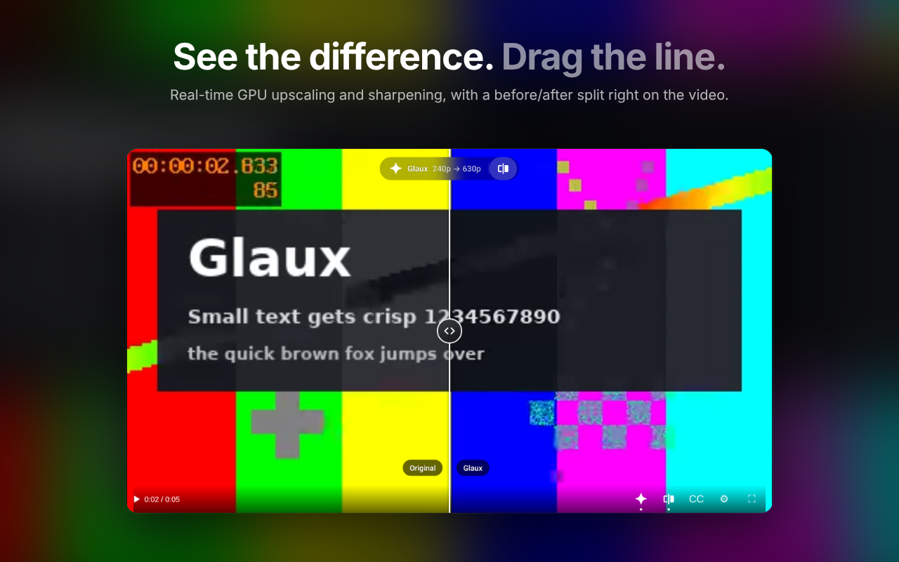

<p align="center">
  
</p>

<h1 align="center">Glaux</h1>

<p align="center"><i>Named after <b>Athene noctua glaux</b>, the little owl of Athena: owls see sharply where others see blur.</i></p>

<p align="center">
  Real-time GPU upscaling and sharpening for web videos.<br>
  One click inside the YouTube player · draggable before/after split · 100% local.
</p>

<p align="center">
  <a href="https://github.com/GGuilhermeAlves/glaux/releases/latest"></a>
  
  
  <a href="LICENSE"></a>
</p>

<p align="center">
  <b>English</b> · <a href="README.pt-BR.md">Português (Brasil)</a>
</p>

<p align="center">
  
</p>

---

## What it does

Most web video is delivered at a lower resolution than your screen, so the browser stretches it with a simple bilinear filter and the result looks soft. **Glaux replaces that last step with a better one.** Every frame is upscaled to the exact number of pixels your player occupies on screen and then run through a contrast-adaptive sharpening pass. All of it happens on your GPU in a few milliseconds per frame.

- **Upscale to your real screen resolution.** A 720p video in a 1440p player is rendered at 1440p, and HiDPI/Retina scaling is taken into account.
- **Sharpening that adapts.** Soft edges and fine detail get more sharpening and areas that are already crisp get less, so bright halos and an "over-sharpened" look are avoided.
- **Compression guard.** Optional noise detection keeps the filter from amplifying grain and blocky compression artifacts.
- **Before/after split.** Drag a handle across the video to see the original on one side and Glaux on the other, live.
- **Native in-player controls.** On YouTube, Glaux adds its buttons to the player's own control bar. On every site, a frosted toggle appears centered at the top of the video when you hover it. It uses the same material as YouTube's own controls: dark, semi-transparent, with a light blur.
- **Works almost everywhere.** It runs on YouTube (including embeds), Twitch, Vimeo, news sites and any other HTML5 `<video>`.
- **Private by design.** There are no servers, accounts, analytics or remote code. Frames never leave your device.

## How it works

Browsers stretch low-resolution video with a basic bilinear filter, which looks soft. Glaux replaces that step on the GPU, once per video frame:

1. **Capture.** The current frame of the `<video>` is uploaded to a WebGL2 texture. Frames are synced with `requestVideoFrameCallback`, so a paused video costs nothing.
2. **Upscale.** A Catmull-Rom bicubic filter resizes the frame to the exact physical pixels of your player (size × screen scale, capped at 1080p/1440p/4K). A min/max clamp prevents halos around edges.
3. **Sharpen.** A contrast-adaptive filter, based on the idea of AMD FSR's RCAS, adds more sharpness where there is room and less on edges that are already strong. The compression guard skips isolated noise and blocky artifacts.
4. **Display.** The result is drawn on a `<canvas>` placed exactly over the video, with `pointer-events: none`, so the site's controls, captions and clicks keep working.

The before/after split runs in the same GPU pass: one side shows the original frame, the other the processed one.

> **Is this AI upscaling?** No. It's a classic image filter, not a neural network, so it's light and works on any GPU. For AI upscaling on NVIDIA RTX cards, enable *RTX Video Super Resolution* in the NVIDIA Control Panel. It can be used together with Glaux.

## Install

Glaux works on **Chromium browsers** (Chrome, Edge, Brave, Opera, Vivaldi, Arc…) and **Firefox 140+** from the same code.

**Stores:** Chrome Web Store *coming soon* · Firefox Add-ons *coming soon*

**Manually on Chromium:**

1. Download `glaux-<version>-chrome.zip` from the [latest release](https://github.com/GGuilhermeAlves/glaux/releases/latest) and extract it to a folder you'll keep.
2. Open `chrome://extensions` (or `edge://extensions`, `brave://extensions`…).
3. Turn on **Developer mode**.
4. Click **Load unpacked** and select the extracted folder (or the `extension/` folder if you cloned the repo).
5. Reload any tabs that were already open.

**Manually on Firefox (temporary, for testing):**

1. Open `about:debugging#/runtime/this-firefox`.
2. Click **Load Temporary Add-on…** and pick `glaux-<version>-firefox.zip` from the [latest release](https://github.com/GGuilhermeAlves/glaux/releases/latest), or `extension/manifest.json` from a clone.
3. If videos aren't enhanced, open `about:addons` → Glaux → **Permissions** and allow access to all websites.

Temporary add-ons are removed when Firefox restarts. For a permanent install, use the signed version from Firefox Add-ons.

## Using it

| Where | What |
|---|---|
| **YouTube control bar** | ✦ toggles Glaux. ◫ opens the before/after split. |
| **Top of any video (hover)** | Frosted toggle with the live resolution, e.g. `480p → 1440p`, plus the split button |
| **Split handle** | Drag it, or focus it and use ← → (Shift for bigger steps). Esc closes. |
| **Toolbar popup** | Global on/off, tab on/off, sharpness, presets, compression guard, auto-enhance, per-site toggle, transparent or solid background, max output |
| **Keyboard** | `Alt+Shift+R` toggles · `Alt+Shift+C` compares (change at `chrome://extensions/shortcuts`) |

## Limitations

- **DRM-protected streams** (Netflix, Prime Video, Disney+, Max…) don't let any page or extension read their pixels. Glaux detects them and shows ✕.
- **Cross-origin video without CORS** is blocked by the browser for the same reason. YouTube, Twitch and most sites work fine.
- When a site makes the bare `<video>` element itself fullscreen (instead of its player container), the browser draws nothing on top of it, so Glaux pauses until you exit fullscreen. YouTube's fullscreen works.
- Sharpening can't recover detail that was never captured. It makes what's there clearer, which helps most with 360p–1080p sources on large or HiDPI screens.

## Privacy

Glaux processes every frame locally on your GPU. It collects nothing, sends nothing and loads no remote code. The only data it stores is your preferences, saved in `chrome.storage.sync` so they follow your browser profile. See [PRIVACY.md](PRIVACY.md).

## Permissions

| Permission | Why |
|---|---|
| Content script on `http(s)://*/*` and `file:///*` | To find `<video>` elements on whatever site you watch and draw the enhanced picture over them |
| `storage` | To save your settings |
| `activeTab` | So the popup can show the current tab's status, toggle it, and draw a blurred, live snapshot of the tab as its frosted background (in memory only, only while the popup is open) |

## Project structure

```
extension/
├── manifest.json          universal MV3 manifest (Chromium + Firefox)
├── content.js             video discovery, WebGL2 renderer, in-player UI
├── background.js          keyboard shortcuts → active tab
├── popup/                 frosted settings popup
├── icons/                 pixel Little Owl icon (Athene noctua glaux)
└── _locales/{en,pt_BR}/   translations
store/                     Chrome Web Store listing texts + images
docs/                      icon source (SVG)
scripts/pack.sh            builds dist/glaux-<version>-chrome.zip and -firefox.zip
.github/workflows/         checks on every push · release zips on every tag
```

## Development

There is no build step. Edit files in `extension/`, then click ↻ on the extension card in `chrome://extensions` (or **Reload** in Firefox's `about:debugging`) and reload the page. The code uses `globalThis.browser ?? globalThis.chrome` with promise-based APIs, so the same files run in both browsers. `pack.sh` writes a clean manifest for each store. To package a release:

```bash
./scripts/pack.sh        # → dist/glaux-1.0.0-chrome.zip + dist/glaux-1.0.0-firefox.zip
```

Pushing a tag `vX.Y.Z` (matching the manifest version) makes GitHub Actions build both zips and publish a release. See [CONTRIBUTING.md](CONTRIBUTING.md).

Adding a language: copy `extension/_locales/en/messages.json` to `extension/_locales/<code>/messages.json` and translate the `message` values.

## Credits

- The sharpening pass is an independent implementation of the robust contrast-adaptive sharpening idea from **AMD FidelityFX™ Super Resolution 1 (RCAS)**, which AMD released under the MIT license.
- The Catmull-Rom 9-tap optimisation is a well-known technique published by several graphics programmers.

## License

[MIT](LICENSE)
