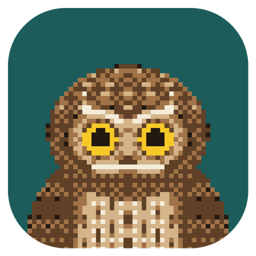
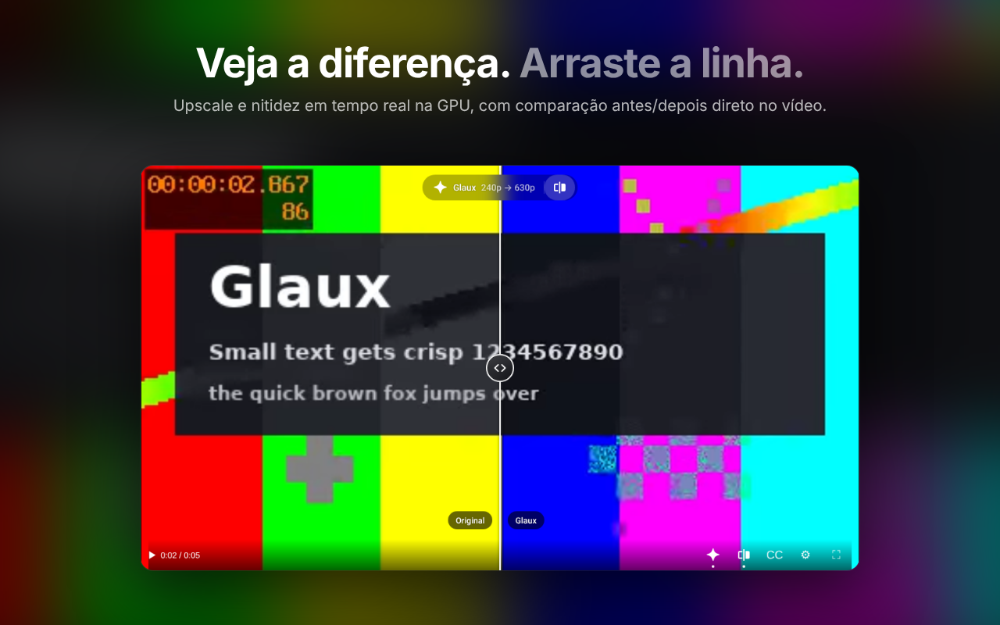

<p align="center">
  
</p>

<h1 align="center">Glaux</h1>

<p align="center"><i>O nome vem da <b>Athene noctua glaux</b>, a corujinha de Atena: corujas enxergam nítido onde os outros veem borrão.</i></p>

<p align="center">
  Upscale e nitidez em tempo real na GPU para vídeos da web.<br>
  Um clique dentro do player do YouTube · comparação antes/depois arrastável · 100% local.
</p>

<p align="center">
  <a href="https://github.com/GGuilhermeAlves/glaux/releases/latest"></a>
  
  
  <a href="LICENSE"></a>
</p>

<p align="center">
  <a href="README.md">English</a> · <b>Português (Brasil)</b>
</p>

<p align="center">
  
</p>

---

## O que ele faz

A maioria dos vídeos da web chega numa resolução menor que a da sua tela. O navegador estica a imagem com um filtro bilinear simples, e o resultado fica "lavado". **O Glaux troca essa última etapa por uma melhor.** Cada quadro é ampliado para o número exato de pixels que o player ocupa na tela e depois passa por um filtro de nitidez adaptativa. Tudo acontece na sua GPU, em poucos milissegundos por quadro.

- **Upscale para a resolução real da tela.** Um vídeo 720p num player de 1440p é renderizado em 1440p, e a escala de telas HiDPI/Retina é levada em conta.
- **Nitidez que se adapta.** Bordas suaves e detalhes finos recebem mais nitidez, e áreas que já estão nítidas recebem menos. Isso evita halos claros e aquele aspecto de "nitidez exagerada".
- **Proteção de compressão.** Uma detecção de ruído opcional impede que o filtro realce granulado e blocos de compressão.
- **Comparação antes/depois.** Arraste uma alça sobre o vídeo para ver o original de um lado e o Glaux do outro, ao vivo.
- **Controles dentro do player.** No YouTube, o Glaux coloca seus botões na própria barra de controles do player. Em qualquer site, um botão fosco aparece centralizado no topo do vídeo quando você passa o mouse. Ele usa o mesmo material dos controles do YouTube: escuro, semitransparente e com um leve desfoque.
- **Funciona em quase tudo.** Roda no YouTube (inclusive vídeos incorporados), Twitch, Vimeo, sites de notícia e qualquer outro `<video>` HTML5.
- **Privado por padrão.** Não há servidor, conta, analytics nem código remoto. Os quadros nunca saem do seu dispositivo.

## Como funciona

O navegador estica vídeos de baixa resolução com um filtro bilinear simples, e a imagem fica "lavada". O Glaux substitui essa etapa na GPU, uma vez por quadro de vídeo:

1. **Captura.** O quadro atual do `<video>` é enviado para uma textura WebGL2. A sincronia é feita com o `requestVideoFrameCallback`, então vídeo pausado não custa nada.
2. **Upscale.** Um filtro bicúbico Catmull-Rom amplia o quadro para o número exato de pixels físicos do player (tamanho × escala da tela, com limite de 1080p, 1440p ou 4K). Um limite de mínimo/máximo evita halos nas bordas.
3. **Nitidez.** Um filtro adaptativo por contraste, baseado na ideia do RCAS do AMD FSR, aplica mais nitidez onde há espaço e menos nas bordas que já são fortes. A proteção de compressão ignora ruído isolado e blocos de compressão.
4. **Exibição.** O resultado é desenhado num `<canvas>` posicionado exatamente sobre o vídeo, com `pointer-events: none`, então os controles, legendas e cliques do site continuam funcionando.

A comparação antes/depois roda no mesmo passo da GPU: um lado mostra o quadro original e o outro, o processado.

> **É upscale por IA?** Não. É um filtro de imagem clássico, e não uma rede neural, por isso é leve e funciona em qualquer GPU. Para upscale por IA em placas NVIDIA RTX, ative o *RTX Video Super Resolution* no Painel de Controle NVIDIA. Ele pode ser usado junto com o Glaux.

## Instalação

O Glaux funciona em **navegadores Chromium** (Chrome, Edge, Brave, Opera, Vivaldi, Arc…) e no **Firefox 140+**, com o mesmo código.

**Lojas:** Chrome Web Store *em breve* · Firefox Add-ons *em breve*

**Manual no Chromium:**

1. Baixe o `glaux-<versão>-chrome.zip` da [última versão](https://github.com/GGuilhermeAlves/glaux/releases/latest) e extraia numa pasta que você não vá apagar.
2. Abra `chrome://extensions` (ou `edge://extensions`, `brave://extensions`…).
3. Ative o **Modo do desenvolvedor**.
4. Clique em **Carregar sem compactação** e selecione a pasta extraída (ou a pasta `extension/`, se você clonou o repositório).
5. Recarregue as abas que já estavam abertas.

**Manual no Firefox (temporário, para testar):**

1. Abra `about:debugging#/runtime/this-firefox`.
2. Clique em **Carregar extensão temporária…** e escolha o `glaux-<versão>-firefox.zip` da [última versão](https://github.com/GGuilhermeAlves/glaux/releases/latest), ou o `extension/manifest.json` de um clone.
3. Se os vídeos não forem melhorados, abra `about:addons` → Glaux → **Permissões** e permita o acesso a todos os sites.

Extensões temporárias somem quando o Firefox reinicia. Para instalar de vez, use a versão assinada da loja Firefox Add-ons.

## Como usar

| Onde | O quê |
|---|---|
| **Barra de controles do YouTube** | ✦ liga e desliga o Glaux. ◫ abre a comparação antes/depois. |
| **Topo de qualquer vídeo (mouse em cima)** | Botão fosco com a resolução ao vivo, ex.: `480p → 1440p`, mais o botão de comparação |
| **Alça da comparação** | Arraste, ou foque nela e use ← → (Shift para passos maiores). Esc fecha. |
| **Popup da barra de ferramentas** | Liga/desliga geral, liga/desliga na aba, nitidez, predefinições, proteção de compressão, ativação automática, controle por site, fundo transparente ou cor fixa e saída máxima |
| **Teclado** | `Alt+Shift+R` liga/desliga · `Alt+Shift+C` compara (mude em `chrome://extensions/shortcuts`) |

## Limitações

- **Streams com DRM** (Netflix, Prime Video, Disney+, Max…) não deixam nenhuma página ou extensão ler os pixels. O Glaux detecta isso e mostra ✕.
- **Vídeo de outro domínio sem CORS** é bloqueado pelo navegador pelo mesmo motivo. YouTube, Twitch e a maioria dos sites funcionam normalmente.
- Quando um site coloca o próprio elemento `<video>` em tela cheia (em vez do container do player), o navegador não desenha nada por cima dele. Nesse caso o Glaux pausa até você sair da tela cheia. A tela cheia do YouTube funciona.
- Nitidez não recupera detalhe que nunca foi gravado. Ela deixa mais claro o que já existe, e ajuda mais em fontes de 360p a 1080p em telas grandes ou HiDPI.

## Privacidade

O Glaux processa cada quadro localmente, na sua GPU. Ele não coleta nada, não envia nada e não carrega código remoto. O único dado salvo são as suas preferências, guardadas em `chrome.storage.sync` para acompanharem o seu perfil do navegador. Veja [PRIVACY.md](PRIVACY.md).

## Permissões

| Permissão | Por quê |
|---|---|
| Content script em `http(s)://*/*` e `file:///*` | Para encontrar elementos `<video>` no site que você estiver assistindo e desenhar a imagem melhorada por cima |
| `storage` | Para salvar suas configurações |
| `activeTab` | Para o popup mostrar o status da aba atual, ligar/desligar nela e desenhar uma foto desfocada e ao vivo da aba como fundo fosco (só na memória e só enquanto o popup está aberto) |

## Estrutura do projeto

```
extension/
├── manifest.json          manifest MV3 universal (Chromium + Firefox)
├── content.js             descoberta de vídeos, renderizador WebGL2, UI no player
├── background.js          atalhos de teclado → aba ativa
├── popup/                 popup de configurações fosco
├── icons/                 ícone da corujinha pixelada (Athene noctua glaux)
└── _locales/{en,pt_BR}/   traduções
store/                     textos e imagens da Chrome Web Store
docs/                      fonte do ícone (SVG)
scripts/pack.sh            gera dist/glaux-<versão>-chrome.zip e -firefox.zip
.github/workflows/         verificação a cada push · zips da release a cada tag
```

## Desenvolvimento

Não há etapa de build. Edite os arquivos em `extension/`, clique em ↻ no card da extensão em `chrome://extensions` (ou em **Recarregar** no `about:debugging` do Firefox) e recarregue a página. O código usa `globalThis.browser ?? globalThis.chrome` com APIs baseadas em promises, então os mesmos arquivos rodam nos dois navegadores. O `pack.sh` gera um manifest limpo para cada loja. Para empacotar uma versão:

```bash
./scripts/pack.sh        # → dist/glaux-1.0.0-chrome.zip + dist/glaux-1.0.0-firefox.zip
```

Ao publicar uma release no GitHub com a tag `vX.Y.Z` (igual à versão do manifest), ou ao enviar essa tag, o GitHub Actions gera os dois zips e os anexa à release. Veja o [CONTRIBUTING.md](CONTRIBUTING.md).

Para adicionar um idioma, copie `extension/_locales/en/messages.json` para `extension/_locales/<código>/messages.json` e traduza os valores de `message`.

## Créditos

- O passo de nitidez é uma implementação independente da ideia de nitidez adaptativa robusta do **AMD FidelityFX™ Super Resolution 1 (RCAS)**, que a AMD liberou sob a licença MIT.
- A otimização Catmull-Rom com 9 amostras é uma técnica conhecida, publicada por vários programadores gráficos.

## Licença

[MIT](LICENSE)
